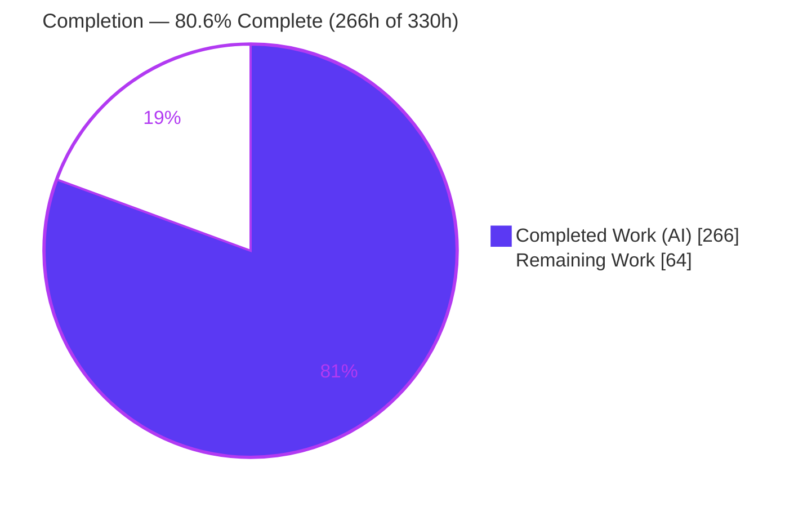
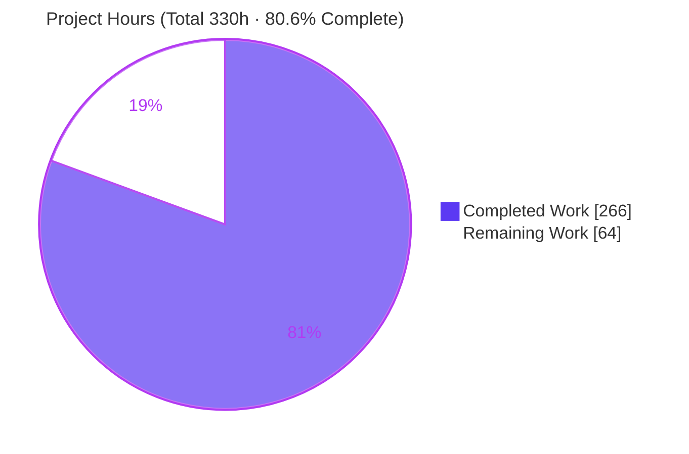
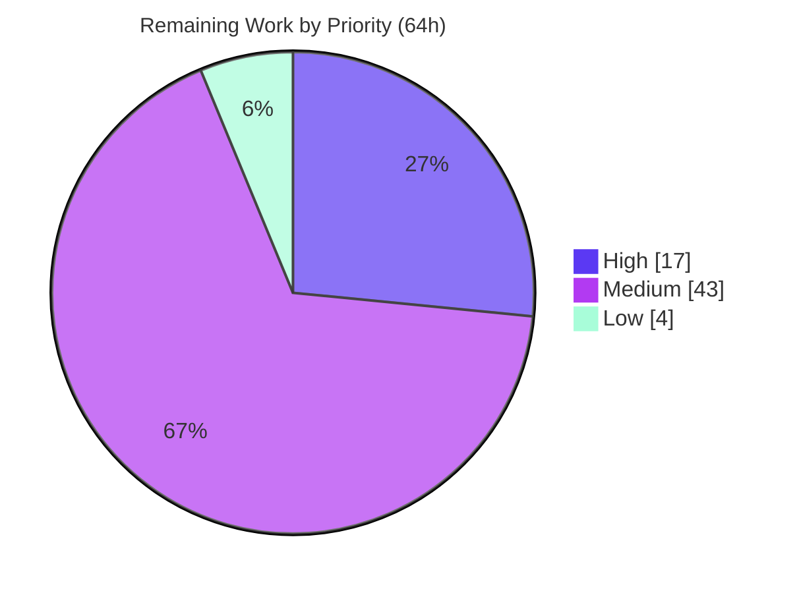

# Blitzy Project Guide — Real-Time Inventory & Flash-Sale System

> **Project:** Real-Time Inventory & Flash-Sale System for a .NET 5 / Angular 11 e-commerce application
> **Branch:** `blitzy-766aed6d-55a8-4ea5-943e-857662ac9975` · **HEAD:** `fc61414`
> **Base:** `origin/feature/automated-test-suite` (merge base `dba5d6a`) · 25 commits · 136 files changed (+11,486 / −421)

---

## 1. Executive Summary

### 1.1 Project Overview

This project adds a **Real-Time Inventory & Flash-Sale System** to an existing .NET 5 / Angular 11 e-commerce store, additively and inside the unchanged `API → Infrastructure → Core` chain. It adds authoritative stock (`Products.StockQuantity`), reservation-based oversell prevention behind a PostgreSQL `SELECT ... FOR UPDATE` row lock, Redis hot-path counters with a fail-closed fallback, live stock over SignalR (`/hubs/stock`), a 30-second reconciliation service, and time-windowed flash-sale pools. Shoppers see live "Only X left!" / "Out of stock" badges and checkout gating; operators get oversell-proof stock during high-demand sales.

### 1.2 Completion Status

**80.6 % complete** against Agent Action Plan (AAP) scope plus path-to-production work: every AAP deliverable is verified, and the remaining 64 hours are environment and operational work.



| Metric | Value |
|---|---|
| **Total Hours** | **330 h** |
| Completed Hours (AI + Manual) | 266 h (266 h AI autonomous · 0 h manual) |
| Remaining Hours | 64 h |
| **Percent Complete** | **80.6 %** |

> Completed `#5B39F3` · Remaining `#FFFFFF`.

### 1.3 Key Accomplishments

- ✅ **Authoritative stock** — `Products.StockQuantity`, `Reservations` and `FlashSales`, applied by one migration at startup.
- ✅ **Zero oversell** — row-locked single writer; 50 concurrent attempts against stock 10 oversell nothing.
- ✅ **Redis hot path, fail-closed** — atomic `DECR`/`INCR`, TTL hold keys, row-locked fallback when Redis is down.
- ✅ **Live stock under 2 seconds** — `StockChanged` over `/hubs/stock`, bridged from Redis without breaking the layering chain.
- ✅ **Self-healing counters** — a 30-second pass reclaims expired holds and re-converges Redis with committed stock.
- ✅ **Flash-sale pools** — reservations bind to the pool active at creation and commit against it.
- ✅ **Live storefront** — an auto-reconnecting stock service drives badges and gating across product, basket and checkout.
- ✅ **Verified quality** — clean build, **711 of 711 tests passing**, catalog and payment contracts untouched.

### 1.4 Critical Unresolved Issues

**0 of the 2 changes requested in the latest round remain open**, and no unresolved code defects remain. Four items below are open on the way to release; none is a code fault.

| Issue | Impact | Owner | ETA |
|---|---|---|---|
| The committed SPA bundle in `API/wwwroot` predates the live-stock UI (it contains no badge, gating or hub code) | A co-hosted production deploy of that bundle would serve a storefront without live stock; a client production build must run in the pipeline | Frontend / DevOps | 3 h (HT-3) |
| No production Redis or PostgreSQL, and no production origins for the API and hub | Cannot deploy or validate outside a developer machine | DevOps | 8 h (HT-2) |
| Secrets are development placeholders and no Stripe keys exist in configuration | Unsafe to deploy as-is; live payment-intent creation and the Stripe webhook cannot run until keys are supplied | DevOps / Security | 6 h (HT-1) |
| Multi-instance fan-out and production-scale load are unverified | Horizontal scaling and peak-traffic behaviour are unproven, though correctness is enforced in PostgreSQL | Backend / SRE | 14 h (HT-5, HT-7) |

### 1.5 Access Issues

| System/Resource | Type of Access | Issue Description | Resolution Status | Owner |
|---|---|---|---|---|
| Production Redis | Service endpoint / credentials | Only the local `docker-compose` instance on `:6379` exists; no managed or HA endpoint | Open — path-to-production (HT-2) | DevOps |
| Production PostgreSQL | Service endpoint / credentials | Only the local `docker-compose` instance on `:5432` (`appuser`/`secret`) exists | Open — path-to-production (HT-2) | DevOps |
| Secrets store (token key, database password) | Secret material | Development placeholders live in `API/appsettings.Development.json`; no secrets manager is wired | Open — path-to-production (HT-1) | DevOps / Security |
| Stripe API keys | Third-party credentials | `StripeSettings:SecretKey` and `StripeSettings:WhSecret` are read by `Infrastructure/Services/PaymentService.cs` and `API/Controllers/PaymentsController.cs` but exist in no checked-in configuration | Open — supply test keys (HT-1) | Payments owner |
| CI/CD system | Pipeline credentials | The repository has no pipeline (outside AAP scope), so no automation runner is provisioned | Open — path-to-production (HT-4) | DevOps |

> No access issue limited this work: the SDK, Node toolchain, Chrome and Docker were available throughout.

### 1.6 Recommended Next Steps

1. **[High]** Externalize secrets and set production configuration, including Stripe keys and API/hub origins. *(HT-1)*
2. **[High]** Provision managed HA Redis and PostgreSQL with TLS and backups, then apply the migration. *(HT-2)*
3. **[High]** Add a client production build and `API/wwwroot` publish step to the pipeline. *(HT-3)*
4. **[Medium]** Stand up a pipeline gating merges on all 711 tests. *(HT-4)*
5. **[Medium]** Validate oversell and hub fan-out at production scale, then add health checks and alerting. *(HT-5, HT-6)*

---

## 2. Project Hours Breakdown

### 2.1 Completed Work Detail

Every component traces to an AAP deliverable group and is evidenced by files on disk, passing tests and observed runtime behaviour.

| Component | Hours | Description |
|---|---:|---|
| Domain model (Core) | 14 | `Reservation`, `FlashSale`, the string-backed `ReservationStatus`/`FlashSaleStatus`, the `IInventoryService`/`IFlashSaleService` contracts, three query specifications and the additive `Product.StockQuantity`. |
| Persistence & migration | 12 | `ReservationConfiguration`/`FlashSaleConfiguration` (FK `Restrict`, enum `HasConversion`, `DateTimeOffset`), `StoreContext` `DbSet`s, the `AddInventoryAndFlashSale` migration, its designer file and the regenerated snapshot. |
| Inventory service — sole stock writer | 40 | Reservation create, extend, commit and release; explicit transaction with a parameterized `SELECT ... FOR UPDATE`; available-stock computation; atomic Redis `DECR`/`INCR`; hold-key TTL; `stock-updates` publishing; fail-closed fallback (886 LOC). |
| Flash-sale pool resolution | 8 | Time-windowed active-sale lookup (`StartsAt ≤ now < EndsAt`) and pool selection for reservation binding. |
| Stock reconciliation service | 16 | 30-second background pass: reclaim expired holds, recompute committed stock, reseed Redis counters, republish corrected values and advance sale windows. |
| SignalR transport & Redis bridge | 18 | Anonymous `StockHub` at `/hubs/stock` with `SubscribeToProduct`, plus the API-layer broadcast service that turns `stock-updates` messages into `StockChanged` group sends. |
| API wiring, configuration & startup seeding | 16 | Basket reserve-before-persist trigger, reservation commit inside the order transaction, Scoped and hosted-service registrations, `AddSignalR`, `MapHub`, credentialed CORS, startup Redis counter seeding and the `Inventory` configuration block. |
| Angular stock service & checkout guard | 26 | Hub lifecycle, exponential-backoff reconnect, full refetch on reconnect, per-product observables (503 LOC) and the route-level checkout stock guard. |
| Angular storefront surfaces | 24 | Product card and detail badges, add-to-cart gating, basket and checkout gating with inline alerts, hub start on app init, the product model, environment URLs and the SignalR client dependency. |
| Automated test suite | 64 | 711 tests across the four existing xUnit projects and colocated Angular specs, including real-PostgreSQL/Redis concurrency, resilience, propagation, reconciliation, migration and contract coverage (~7,200 test LOC). |
| Concurrency, resilience & edge hardening | 20 | Basket-level reserve compensation, commit-path lock ordering, reconciliation indexing, extend-to-zero counter consistency, broadcast-bridge recovery and terminal-reconnect recovery in the client. |
| Runtime & cross-client verification | 8 | SignalR version alignment research plus live verification of startup seeding, negotiate, credentialed CORS, the reservation write path, the Pub/Sub payload shape and cross-client badge propagation. |
| **Total Completed** | **266** | **Matches Completed Hours in §1.2.** |

### 2.2 Remaining Work Detail

All remaining work is path-to-production; none of it is AAP feature scope. Each category maps to a task in §8 and, where it closes a gap, to §5.2.

| Category | Hours | Priority |
|---|---:|---|
| Production environment, secrets and Stripe key configuration (HT-1) | 6 | High |
| Managed Redis & PostgreSQL provisioning, HA/TLS/backups, migration apply (HT-2) | 8 | High |
| Client production build & `API/wwwroot` publish step (HT-3) | 3 | High |
| CI/CD pipeline: build, 711-test gate, deploy (HT-4) | 10 | Medium |
| Production-scale load & concurrency validation (HT-5) | 8 | Medium |
| Monitoring & observability: health checks, metrics, alerting (HT-6) | 8 | Medium |
| Production CORS origins & SignalR multi-instance hardening (HT-7) | 6 | Medium |
| Flash-sale operational tooling & runbook (HT-8) | 5 | Medium |
| Security review & abuse/rate-limit hardening (HT-9) | 5 | Medium |
| Basket `409 Conflict` contract documentation for API consumers (HT-10) | 1 | Medium |
| Production deployment & smoke verification (HT-11) | 4 | Low |
| **Total Remaining** | **64** | **Matches Remaining Hours in §1.2 and §7.** |

### 2.3 Hours Reconciliation

| Check | Result |
|---|---|
| Completed (§2.1) + Remaining (§2.2) | 266 + 64 = **330 h** = Total (§1.2) ✅ |
| Completion % | 266 / 330 = **80.6 %** ✅ |
| Remaining consistency (§1.2 ↔ §2.2 ↔ §7) | 64 = 64 = 64 ✅ |

---

## 3. Test Results

Every number below comes from a complete, independent execution of the suites at the current branch tip: `dotnet build ecommerce-shop.sln -c Debug` (**0 warnings, 0 errors**, 7 assemblies) followed by all four xUnit projects and the Angular Karma suite. Coverage is line coverage, collected with `coverage.runsettings` and `XPlat Code Coverage` for .NET and the Karma istanbul reporter for the client.

| Area / Category | Framework | Tests | Passed | Failed | Coverage | What This Proves |
|---|---|---:|---:|---:|---|---|
| Domain model & query specifications (Core) | xUnit 2.4.2 + FluentAssertions 6.12.0 | 146 | 146 | 0 | 98.2 % (Core) | Reservation and flash-sale state, their string-backed status values, and the active, expired and active-sale specifications behave as specified. |
| Inventory, flash-sale & reconciliation services (Infrastructure) | xUnit + Moq 4.18.4 + EF Core InMemory | 129 | 129 | 0 | 76.6 % (Infrastructure) | The single-writer reservation lifecycle, pool selection by time window, counter mutation, hold-key TTL and expiry reclaim are correct, including Redis-unavailable paths. |
| Controllers, hub & broadcast bridge (API) | xUnit | 86 | 86 | 0 | 62.3 % (API) | The basket reserve-before-persist call site with its insufficient-stock rejection, and the Redis-to-SignalR bridge, are wired and tolerate malformed or absent messages. |
| End-to-end concurrency, resilience, migration & contracts | xUnit + Testcontainers 3.9.0 + Mvc.Testing 5.0.17 | 119 | 119 | 0 | 79.0 % overall (Core 85.1 %, API 86.1 %, Infrastructure 72.2 %) | Against real PostgreSQL and Redis: 50 concurrent attempts against stock 10 oversell zero units; a Redis outage falls back to the row-locked check; `StockChanged` reaches a hub client in under 2,000 ms; Redis and PostgreSQL re-converge within one reconciliation interval; the migration applies cleanly and basket, order and payment contracts are unchanged. |
| Storefront components, stock service & route guard (Angular) | Karma + Jasmine, headless Chrome 153 | 231 | 231 | 0 | 95.3 % lines, 84 % branches | Badge copy at the threshold boundaries and "Out of stock" at zero, add-to-cart and proceed/submit gating, hub connect and reconnect-refetch behaviour, and the checkout route guard render and gate as designed. |
| **Total** | — | **711** | **711** | **0** | — | **100 % pass rate, 0 skipped, on a clean build.** |

**Not Covered** — delivered behaviour that no test exercises, and what to test before release:

- **The deployable co-hosted SPA bundle.** All client verification runs against `client/src` through Karma and the dev server; the committed bundle in `API/wwwroot` is exercised by nothing. Run a client production build and re-check badges and gating against the served bundle (see §5.2).
- **Multi-instance operation.** Every run is single-instance. Two API instances sharing one Redis — hub group fan-out across instances and two concurrent reconciliation loops — is untested; exercise it before scaling out.
- **The live Stripe path.** Payment-intent creation and the webhook are exercised only through a stubbed payment service; nothing covers real Stripe calls, because no keys are present in configuration.
- **Sustained load.** The oversell proof is 50 simultaneous attempts in one process; throughput, hub connection counts and reservation churn at production scale are unmeasured.
- **Client style analysis.** TSLint is not part of the gate: `npx ng lint` exits non-zero with 221 findings across the client (chiefly quote style and missing return-type annotations), spanning both long-standing files and files this work touched. Whether to clean them up is a separate decision.

---

## 4. Runtime Validation & UI Verification

The application was run against live PostgreSQL and Redis and driven through its storefront in a real browser (headless Chrome 153, Angular dev server on `https://localhost:4200`, API and hub on `https://localhost:5001`).

- ✅ **Startup** — migrations apply (`Products.StockQuantity`, `Reservations`, `FlashSales`), 18 products seed, all 18 `stock:product:*` counters warm from committed stock, the reconciliation service starts on its 30-second interval and the broadcast bridge sends its first `StockChanged`.
- ✅ **Cached catalog intact** — `GET /api/products` returns 200 with 18 products and no stock field in the DTO, so live stock never enters the response cache.
- ✅ **Hub reachable** — `POST /hubs/stock/negotiate` returns 200 offering WebSockets, Server-Sent Events and Long Polling; the browser upgrades to `wss://.../hubs/stock` on every page load with no transport fallback.
- ✅ **Credentialed CORS** — an `OPTIONS` preflight from `https://localhost:4200` returns 204 with `access-control-allow-credentials: true` and that exact origin, not a broadened one.
- ✅ **Authentication** — `POST /api/account/login` with the seeded account returns 200 and a JWT.
- ✅ **Reservation write path** — `POST /api/basket` returns 200, decrements the counter atomically (1000 → 998), writes an `Active` reservation with a 10-minute expiry, sets the hold key with a 598-second TTL and publishes exactly `{"productId":1,"currentStock":998,"flashSaleId":null}`.
- ✅ **Insufficient stock** — an over-quantity basket update returns `409 Conflict` naming the short product and leaves the previously persisted basket untouched.
- ✅ **Reconciliation convergence** — committed stock changed directly in PostgreSQL (to 3 and to 0) was mirrored into the Redis counters within one 30-second interval.
- ✅ **Storefront** — badges render exactly "Only 3 left!" at stock 3 and "Out of stock" at stock 0 with add-to-cart disabled and inert; stock-rich products show no badge; adding to the basket moves the badge live from 3 to 2 with no reload; the basket line renders with checkout enabled; across 90 requests there were no console errors and no response above status 399.
- ⚠ **Not exercised at runtime** — the committed `API/wwwroot` bundle (only the dev-served client was driven), a second API instance sharing Redis, the live Stripe payment path, and sustained production-scale load.

---

## 5. Compliance & Quality Review

### 5.1 Compliance Matrix

Each row states where the deliverable stands now, with evidence you can open.

| Benchmark / AAP Directive | Status | Evidence |
|---|---|---|
| `API → Infrastructure → Core` chain and DI lifetimes preserved | ✅ Pass | No Infrastructure-to-API reference; broadcasting crosses the boundary through the Redis `stock-updates` channel into `API/Hubs/StockBroadcastBackgroundService.cs`; services registered Scoped in `API/Extension/ApplicationServicesExtensions.cs`. |
| `IInventoryService` is the sole writer of reservations and Redis stock keys | ✅ Pass | All reservation and counter writes live in `Infrastructure/Services/InventoryService.cs`; basket compensation routes back through the same interface (`API/Controllers/BasketController.cs`). |
| Row lock at reservation creation **and** at order commit | ✅ Pass | Parameterized `SELECT * FROM "Products" WHERE "Id" = {0} FOR UPDATE` inside explicit transactions (`InventoryService.cs:106`, `:394`); order finalization commits holds in the same transaction (`Infrastructure/Services/OrderService.cs`). |
| Redis mutated only by atomic `DECR`/`INCR`, with TTL hold keys | ✅ Pass | `stock:product:{id}` increment and decrement plus `reservation:{basketId}:{productId}`, whose TTL was observed at 598 s for a 10-minute reservation. |
| Fail-closed when Redis is unreachable | ✅ Pass | The row-locked check is authoritative; startup counter seeding is isolated so an outage cannot assume stock (`API/Program.cs`), and the resilience tests exercise the fallback. |
| Expiry only through reconciliation | ✅ Pass | `Infrastructure/Services/StockReconciliationService.cs` reclaims expired `Active` holds on its interval; the Redis TTL is an optimisation, not the authority. |
| Propagation to other clients under 2 seconds | ✅ Pass | `API.IntegrationTests/Inventory/StockPropagationTests.cs` asserts delivery under 2,000 ms; a browser session saw a badge move 3 → 2 with no reload. |
| Flash-sale pool bound at creation and committed against | ✅ Pass | `Infrastructure/Services/FlashSaleService.cs` resolves the active window; the reservation stores its `FlashSaleId`, null for general stock. |
| Verbatim artifacts — keys, channel, payload, statuses, hub route and method names | ✅ Pass | Observed payload `{"productId":1,"currentStock":998,"flashSaleId":null}` on `stock-updates`; hub at `/hubs/stock` with `SubscribeToProduct` and `StockChanged`; the `Inventory` block reads 10, 5 and 30. |
| Live stock kept out of the cached catalog | ✅ Pass | `API/Controllers/ProductsController.cs`, `API/Dtos/ProductToReturnDto.cs` and `API/Helpers/MappingProfiles.cs` are unchanged; the served DTO has no stock field. |
| Invariants — Stripe flow, `OrderStatus`, test configuration untouched | ✅ Pass | `Infrastructure/Services/PaymentService.cs`, `Core/Entities/OrderAggregate/OrderStatus.cs`, `coverage.runsettings`, `client/karma.conf.js` and `client/src/test.ts` show no change against the base. |
| Dependencies and code hygiene | ✅ Pass | Only `@microsoft/signalr ^5.0.17` (client) and `Microsoft.AspNetCore.SignalR.Client 5.0.17` (integration tests) added, with no server package; zero `TODO`, `FIXME` or `NotImplementedException` markers across `Core`, `Infrastructure`, `API` and `client/src`; build is 0 warnings and 0 errors. |

### 5.2 AAP & Rule Divergences and Gaps

| What the AAP/Rule Required | What Was Delivered Instead | Why It Diverged | Impact | Remediation |
|---|---|---|---|---|
| Badge copy stated verbatim as "Only N left!" (AAP §0.1.2, §0.5.3, §0.8) | §1.1 of this guide describes the badge as "Only X left!"; the application still renders "Only N left!" | **Sanctioned** — you asked for that wording in the Project Overview, with an accompanying instruction to change nothing else | Documentation wording only; no behavioural effect | None required; decide later whether to harmonise the wording |
| Existing basket request and response contracts unchanged | `POST /api/basket` reserves before persisting and returns `409 Conflict` when a line cannot be fully held | Reserve-before-persist needs a way to reject an unreservable update, and no existing status expressed it | Non-Angular consumers see a status they do not handle | Document the `409` response for API consumers (HT-10, 1 h) |
| Frontend scope limited to the enumerated components and the stock service | A checkout route guard, a `409` toast in the error interceptor and a basket re-fetch on rejection were added | Design decisions taken during delivery to defend a directly navigated `/checkout` URL and to prevent a phantom basket quantity | Slightly wider client surface to maintain; behaviour matches the AAP's gating intent | None required; review and accept as delivered |
| Persistence scope limited to the context, entity configurations and the migration | `IUnitOfWork` and `UnitOfWork` gained an explicit transaction lifecycle | The AAP required order finalization to hold the row lock until order and stock changes flush together, which `Complete()` alone could not do | Core gains three persistence-agnostic methods; no EF Core type leaks into Core | None required; accept as an intentional extension |
| Migration scaffolded with the EF Core CLI | The migration is hand-authored with the synthetic timestamp `20240101000000` | Not scaffolded in this run — the file was written directly and the snapshot updated by hand | Cosmetic only: it sorts after the initial migration and applies cleanly | None required; scaffold the next migration normally |
| A live-stock storefront in production (AAP §0.5.3) | The client source delivers it, but the committed `API/wwwroot` bundle still predates the feature | Regenerating the bundle rewrites tracked build output and sat outside the enumerated scope | A co-hosted deploy of the committed bundle would show no badges or gating | Add a client production build and publish step to the pipeline (HT-3, 3 h) |

**Badge copy in the Project Overview.** The AAP fixes the low-stock copy as "Only N left!" and takes it verbatim from the original prompt. You asked for the Project Overview in this guide to read "Only X left!" and for nothing else to change, so the wording differs in §1.1 only: this guide's other references and the shipped templates still read "Only N left!" (`client/src/app/shop/product-item/product-item.component.html:26`, `client/src/app/shop/product-details/product-details.component.html:17`), and a browser session confirmed the storefront renders "Only 3 left!" at stock 3. Nothing behavioural follows from the difference. If you would rather the wording be consistent, changing the templates and their specs is a small, contained edit; leaving it as it stands costs nothing.

**Basket endpoint now has a `409` failure mode.** The AAP required the basket write path to create or extend a reservation while keeping existing contracts unchanged. Delivery reserves every line before persisting and, when a line cannot be fully held, compensates the holds it already granted and returns `409 Conflict` naming the short product ids (`API/Controllers/BasketController.cs:71-110`); the observed body is `{"statusCode":409,"message":"Insufficient stock ... The basket was not updated."}`. The success shape is untouched, so the Angular client and the contract regression tests pass unchanged, and the client surfaces the message and re-fetches the authoritative basket. Any other consumer of `POST /api/basket` needs the new status documented and handled — one hour of work (HT-10).

**Client surface beyond the enumerated list.** Besides the components the AAP named, delivery added `client/src/app/core/guards/stock.guard.ts`, wired as `canActivate` on the `/checkout` route in `client/src/app/app-routing.module.ts`, a `409` branch in `client/src/app/core/interceptors/error.interceptor.ts`, and a re-fetch in `client/src/app/basket/basket.service.ts` that reverts an optimistic quantity the server rejected. The reasoning is sound: component-level gating alone can be bypassed by typing or bookmarking `/checkout`, and an optimistic basket mutation would otherwise linger after a rejection. All three are covered by specs, including eight cases in `stock.guard.spec.ts`. Nothing needs undoing; the decision is simply wider than the plan you approved, so it is recorded here.

**Unit-of-work transaction lifecycle.** The AAP listed only the context, entity configurations and the migration under persistence, yet also required the commit-path row lock to be held until the order rows and the stock decrement flush together. `Complete()` only called `SaveChangesAsync`, so `Core/Interfaces/IUnitOfWork.cs` gained `BeginTransactionAsync`, `CommitTransactionAsync` and `RollbackTransactionAsync`, implemented in `Infrastructure/Data/UnitOfWork.cs` as no-ops on non-relational providers so the in-memory unit tests still run. No EF Core type enters Core, so the dependency rule holds. Treat this as an approved extension of the plan rather than a defect: the alternative was to leave the required lock unenforceable at order finalization.

**Hand-authored migration.** The AAP expected `dotnet ef migrations add AddInventoryAndFlashSale` to scaffold the schema and regenerate the snapshot. The delivered migration, `Infrastructure/Data/Migrations/20240101000000_AddInventoryAndFlashSale.cs`, was written directly with a synthetic timestamp rather than generated in this run. It adds `Products.StockQuantity`, `Reservations` and `FlashSales`, applies cleanly on a real PostgreSQL instance (exercised by the migration tests and by every startup) and sorts after the initial `20211212023144` migration, so ordering is correct. The only consequence is that the timestamp does not reflect authorship time; scaffold the next migration with the CLI as usual.

**Committed SPA bundle predates the feature.** `client/src/environments/environment.prod.ts` points at relative `api/` and `hubs/`, so the SPA is co-hosted from `API/wwwroot` in production — but none of the nine JavaScript files committed there contains `SubscribeToProduct`, `StockChanged` or "Out of stock", meaning that bundle is the pre-feature storefront. Regenerating it requires a client production build, which rewrites tracked output and was outside the enumerated scope. Until a build step is added, deploying the repository as it stands serves a storefront with no badges or gating while the API reserves stock behind it. Add the build and publish step to the release pipeline (HT-3, 3 h) and re-run the storefront checks against the served bundle.

---

## 6. Risk Assessment

The feature code is verified, so the residual risks are forward-looking and mostly operational.

| Risk | Category | Severity | Probability | Mitigation | Status |
|---|---|---|---|---|---|
| No production Redis or PostgreSQL, and no production API or hub origins | Integration | High | High | Provision managed HA instances with TLS and backups, apply the migration, set real origins | Open |
| Development placeholder secrets, and no Stripe keys in configuration | Security | High if deployed as-is | Medium | Move secrets to a manager, inject per environment, supply Stripe keys before enabling payments | Open |
| Committed SPA bundle predates the live-stock UI | Operational | Medium | High | Add a client production build and publish step to the pipeline | Open |
| Hub fan-out across multiple API instances relies on each instance's own Redis subscriber rather than a SignalR backplane | Technical | Medium | Medium | Validate with two instances; add a Redis backplane or connection affinity if group fan-out suffers | Open |
| Client-owned basket ids with no foreign key, and an anonymous hub negotiate, allow stock-holding or connection abuse | Security | Medium | Low–Medium | Rate-limit the basket write path and negotiate at the gateway; hold TTL plus reclaim already bound the exposure | Partially mitigated |
| Redis is the hot path, so an outage degrades latency and pauses live badges | Integration | Medium | Low–Medium | The row-locked fallback keeps correctness; provision HA Redis for availability | Mitigated for correctness |
| Redis and PostgreSQL can diverge transiently inside one reconciliation interval | Technical | Low | Low | The commit-time row lock is authoritative regardless, and the interval is configurable | Mitigated by design |
| Operational readiness: no automated test gate, no health checks or metrics for Redis and the reconciliation loop, and flash sales configured by direct data insertion | Operational | Medium | Medium | Stand up the pipeline, add health endpoints, metrics and alerts, and publish a flash-sale seeding runbook | Open |

---

## 7. Visual Project Status

**Project hours breakdown** — Completed = Dark Blue `#5B39F3`, Remaining = White `#FFFFFF`.



**Remaining work by priority** (64 h total).



**Remaining hours per category** (§2.2):

| Category | Hours | Bar |
|---|---:|---|
| CI/CD pipeline | 10 | ██████████ |
| Redis + PostgreSQL provisioning | 8 | ████████ |
| Load & concurrency validation | 8 | ████████ |
| Monitoring & observability | 8 | ████████ |
| Environment, secrets & Stripe keys | 6 | ██████ |
| CORS origins + multi-instance hardening | 6 | ██████ |
| Flash-sale tooling & runbook | 5 | █████ |
| Security review & rate limits | 5 | █████ |
| Deployment & smoke verification | 4 | ████ |
| Client production build & publish step | 3 | ███ |
| Basket `409` contract documentation | 1 | █ |
| **Total** | **64** | |

> Integrity: "Remaining Work" = **64 h** in the pie chart equals §1.2 Remaining Hours and the §2.2 Hours total.

---

## 8. Summary & Recommendations

**What was delivered and verified.** The Real-Time Inventory & Flash-Sale System is implemented across all six AAP deliverable groups — domain model, persistence and migration, services and real-time transport, API wiring, storefront and tests — and it holds up under examination. The solution builds with 0 warnings and 0 errors, and all **711 tests pass** (Core 146, Infrastructure 129, API 86, integration 119 against real PostgreSQL and Redis, Angular 231), with 98.2 % line coverage on Core, 95.3 % on client lines and 86.1 % on the API through the integration suite. Running the application confirmed the behaviour end to end: counters warm at startup, the reservation write path decrements atomically and publishes the exact documented payload, an over-quantity update is refused with `409`, Redis re-converges with PostgreSQL inside one 30-second interval, and a browser saw a live badge move from 3 to 2 with no reload and no console errors.

**Where the gaps are.** The project stands at **80.6 % complete (266 h of 330 h)**. The outstanding **64 h is entirely path-to-production**: environment and secret configuration including Stripe keys, managed HA datastores, a release pipeline carrying the test gate, production-scale load and multi-instance validation, monitoring, flash-sale operational tooling, security hardening and deployment. One packaging gap deserves attention ahead of the rest: the committed `API/wwwroot` bundle predates the live-stock UI, so deploying the repository as it stands would serve the old storefront while the API reserves stock behind it (§5.2).

**Divergences worth your decision.** Six departures from the plan are recorded in §5.2. One is sanctioned wording you requested; one adds a `409` failure mode to `POST /api/basket` that non-Angular consumers must handle; three are wider-than-planned but sound engineering decisions (a checkout route guard with client-side rejection handling, a unit-of-work transaction lifecycle, and a hand-authored migration); and the last is the SPA bundle gap above. Only two of the six need work, totalling four hours.

**Critical path to production.** Externalize secrets and set production configuration, then provision managed Redis and PostgreSQL and apply the migration, then add the client production build and publish step, then gate merges on the full suite, then validate at production-scale load with observability in place, and finally deploy and smoke-test. Success metrics to confirm in a production-like environment: zero oversell at peak concurrency, `StockChanged` delivered under two seconds at scale, convergence within one reconciliation interval, and graceful degradation during a Redis outage.

**Production readiness.** Feature-complete and verified, not yet production-deployed. The engineering risk is retired: correctness rests on a PostgreSQL row lock that holds even when Redis is absent, and the verification behind that claim is reproducible from this repository with the commands in §9. The recommended posture is to move to staging immediately behind the three High-priority tasks, then to production once load validation and monitoring are in place.

| Metric | Value |
|---|---|
| AAP deliverables complete | 100 % |
| Automated tests passing | 711 / 711 (100 %) |
| Overall completion (AAP + path-to-production) | 80.6 % |
| Remaining effort | 64 h (path-to-production) |
| Release-blocking code defects | 0 |

---

## 9. Development Guide

Every command below was executed in a clean checkout of this branch. Run them from the repository root unless stated otherwise.

### 9.1 System Prerequisites

- **.NET 5 SDK** — verified with 5.0.408 (runtime 5.0.17). All seven projects target `net5.0` and there is no `global.json`.
- **Node.js and npm** — verified with Node 22.23.2 and npm 11.18.0. On Node 17 or newer, `NODE_OPTIONS=--openssl-legacy-provider` is mandatory for every Angular 11 command.
- **Docker** — runs PostgreSQL and Redis locally and is required by the integration tests, which start their own containers.
- **Google Chrome** — verified with Chrome 153, used by the Karma suite through `CHROME_BIN`.

Environment variables to export in any shell that builds, tests or runs:

```bash
export DOTNET_CLI_TELEMETRY_OPTOUT=1 DOTNET_NOLOGO=1
export NODE_OPTIONS=--openssl-legacy-provider
export CHROME_BIN=/usr/bin/google-chrome
```

### 9.2 Environment Setup

Start the datastores defined by `docker-compose.yml` — PostgreSQL on 5432 as `appuser`/`secret`, Redis on 6379, plus the optional `adminer` and `redis-commander` UIs:

```bash
docker compose up -d db redis
docker compose ps
```

Configuration lives in `API/appsettings.Development.json`, whose connection strings target databases `e-commerce` and `identity` on `localhost:5432` and Redis on `localhost`. The additive inventory block is:

```json
"Inventory": { "ReservationTtlMinutes": 10, "LowStockThreshold": 5, "ReconciliationIntervalSeconds": 30 }
```

Client endpoints live in `client/src/environments/environment.ts` (`apiUrl: https://localhost:5001/api/`, `hubUrl: https://localhost:5001/hubs/`). `environment.prod.ts` uses relative `api/` and `hubs/` because the SPA is co-hosted from `API/wwwroot` in production.

### 9.3 Dependency Installation

```bash
dotnet restore ecommerce-shop.sln
cd client && CI=true npm ci && cd ..
```

`npm ci` installs against the committed lockfile and prints `EBADENGINE` warnings plus an ignored-build-scripts notice on npm 11; both are cosmetic. Do not run `npm audit fix`, which would break the pinned Angular 11 toolchain.

### 9.4 Build

```bash
dotnet build ecommerce-shop.sln -c Debug
cd client && npx ng build && cd ..
```

The backend build is expected to print `Build succeeded.` with `0 Warning(s)` and `0 Error(s)`. **`ng build` writes into the git-tracked `API/wwwroot`**; either keep that output deliberately, since it is what a co-hosted deployment serves, or restore it afterwards:

```bash
git checkout -- API/wwwroot && git clean -fd API/wwwroot
```

### 9.5 Run the Application

```bash
ASPNETCORE_ENVIRONMENT=Development \
ASPNETCORE_URLS="https://localhost:5001;http://localhost:5000" \
dotnet run --project API --no-launch-profile
```

To serve HTTPS with your own certificate instead of the .NET development certificate, add `ASPNETCORE_Kestrel__Certificates__Default__Path=<path-to-pfx>` and `ASPNETCORE_Kestrel__Certificates__Default__Password=<password>`; otherwise run `dotnet dev-certs https --trust` once. Startup applies the migrations, seeds 18 products with stock, warms every `stock:product:*` counter from committed stock, starts the 30-second reconciliation service and subscribes the broadcast bridge to `stock-updates`. A Kestrel warning about the IPv6 loopback is benign in containers.

Run the storefront from source in a second shell — Angular serves HTTPS on 4200 using the certificates configured in `client/angular.json`, which is the origin the API's CORS policy allows:

```bash
cd client && npx ng serve --port 4200
```

Sign in with the seeded account `bob@test.com` / `Pa$$w0rd`.

### 9.6 Verification Steps

```bash
curl -sk https://localhost:5001/api/products | head -c 400
curl -sk -o /dev/null -w "%{http_code}\n" -X POST "https://localhost:5001/hubs/stock/negotiate?negotiateVersion=1"
curl -skI -X OPTIONS https://localhost:5001/api/products -H "Origin: https://localhost:4200" -H "Access-Control-Request-Method: GET"
redis-cli --scan --pattern 'stock:product:*' | wc -l
redis-cli GET stock:product:1
```

Expected: the catalog returns 200 with 18 products and **no** stock field; negotiate returns `200`; the preflight returns `204` with `access-control-allow-credentials: true`; 18 counters exist and product 1 reports its available stock. To watch the real-time path, subscribe in one shell and post a basket in another:

```bash
redis-cli SUBSCRIBE stock-updates
curl -sk -X POST https://localhost:5001/api/basket -H "Content-Type: application/json" \
  -d '{"id":"demo-basket","items":[{"id":1,"productName":"demo","price":200,"quantity":2,"pictureUrl":"x","brand":"b","type":"t"}]}'
```

The subscriber prints `{"productId":1,"currentStock":998,"flashSaleId":null}`, the counter drops by two, and `reservation:demo-basket:1` appears with a TTL of about 600 seconds.

### 9.7 Running Tests

```bash
dotnet test Core.Tests/Core.Tests.csproj --no-build -c Debug -v minimal
dotnet test Infrastructure.Tests/Infrastructure.Tests.csproj --no-build -c Debug -v minimal
dotnet test API.Tests/API.Tests.csproj --no-build -c Debug -v minimal
dotnet test API.IntegrationTests/API.IntegrationTests.csproj --no-build -c Debug -v minimal
cd client && npx ng test --watch=false --browsers=ChromeHeadlessNoSandbox && cd ..
```

Expected counts are 146, 129, 86, 119 and 231 — **711 tests, 0 failures**. The integration project needs Docker and takes about 51 seconds. For coverage, append `--settings coverage.runsettings --collect:"XPlat Code Coverage" --results-directory <dir>` to any `dotnet test`, and add `--code-coverage` to `ng test`.

### 9.8 Example Usage (live stock flow)

1. Set a low stock value for one product, for example `UPDATE "Products" SET "StockQuantity"=3 WHERE "Id"=2;` — within one reconciliation interval the Redis counter follows.
2. Open the shop in two browsers; both product cards show the low-stock badge, and stock-rich products show none.
3. Add that product to the basket in the first browser; the second browser's badge decrements within about two seconds.
4. Drive the product to zero; the badge becomes "Out of stock", add-to-cart is disabled, and basket and checkout refuse to proceed with an inline alert.
5. Stop Redis with `docker compose stop redis` and add to the basket again; the request is still served correctly through the row-locked PostgreSQL check while live badges pause until Redis returns.

### 9.9 Troubleshooting

- **`ERR_OSSL_EVP_UNSUPPORTED` from any Angular command** — export `NODE_OPTIONS=--openssl-legacy-provider`, or use Node 14 or 16.
- **Integration tests cannot start containers** — confirm the Docker daemon is reachable with `docker info`; the tests pull digest-pinned PostgreSQL and Redis images.
- **Browser certificate warning on 4200 or 5001** — the certificates in `client/ssl` are self-signed, so accept the interstitial, or trust the .NET development certificate with `dotnet dev-certs https --trust`.
- **No live badge updates** — check that negotiate returns 200 and that the SPA origin matches the credentialed CORS policy in `API/Startup.cs`; the client logs `WebSocket connected to wss://.../hubs/stock` when the hub is live.
- **Counters look stale** — the reconciliation pass re-converges Redis with PostgreSQL every 30 seconds, and PostgreSQL remains the source of truth, so no manual counter edit is needed.
- **Payments fail in a development run** — `StripeSettings:SecretKey` and `StripeSettings:WhSecret` are absent from checked-in configuration; supply Stripe test keys through your own configuration source.

---

## 10. Appendices

### A. Command Reference

| Purpose | Command |
|---|---|
| Restore backend | `dotnet restore ecommerce-shop.sln` |
| Build backend | `dotnet build ecommerce-shop.sln -c Debug` |
| Install client dependencies | `CI=true npm ci` (in `client/`) |
| Build client | `npx ng build` (in `client/`; writes the tracked `API/wwwroot`) |
| Run API | `ASPNETCORE_URLS="https://localhost:5001;http://localhost:5000" dotnet run --project API --no-launch-profile` |
| Serve client | `npx ng serve --port 4200` (in `client/`) |
| Start datastores | `docker compose up -d db redis` |
| Stop datastores | `docker compose down` |
| Backend tests | `dotnet test <Project>/<Project>.csproj --no-build -c Debug -v minimal` |
| Client tests | `npx ng test --watch=false --browsers=ChromeHeadlessNoSandbox` (in `client/`) |
| Client lint | `npx ng lint` (in `client/`; not part of the test gate) |
| Inspect a counter | `redis-cli GET stock:product:1` |
| Watch broadcasts | `redis-cli SUBSCRIBE stock-updates` |

### B. Port Reference

| Service | Port | Notes |
|---|---|---|
| API (HTTPS) | 5001 | Kestrel; serves the API, the co-hosted SPA and the SignalR hub |
| API (HTTP) | 5000 | Kestrel |
| Angular dev server | 4200 | HTTPS via `client/angular.json`; the only origin the CORS policy allows |
| PostgreSQL | 5432 | `appuser` / `secret` in development; databases `e-commerce` and `identity` |
| Redis | 6379 | Stock counters, hold keys and the `stock-updates` channel |
| adminer | 8080 | Optional database UI from `docker-compose.yml` |
| redis-commander | 8081 | Optional Redis UI from `docker-compose.yml` (`root` / `secret`) |

### C. Key File Locations

| Area | Path |
|---|---|
| Sole stock writer | `Infrastructure/Services/InventoryService.cs` |
| Flash-sale resolution | `Infrastructure/Services/FlashSaleService.cs` |
| Reconciliation service | `Infrastructure/Services/StockReconciliationService.cs` |
| SignalR hub | `API/Hubs/StockHub.cs` |
| Redis-to-hub bridge | `API/Hubs/StockBroadcastBackgroundService.cs` |
| Reservation trigger | `API/Controllers/BasketController.cs` |
| Reservation commit | `Infrastructure/Services/OrderService.cs`, `Infrastructure/Data/UnitOfWork.cs` |
| DI, SignalR and CORS wiring | `API/Extension/ApplicationServicesExtensions.cs`, `API/Startup.cs` |
| Startup seeding | `API/Program.cs` |
| Migration | `Infrastructure/Data/Migrations/20240101000000_AddInventoryAndFlashSale.cs` |
| Domain entities | `Core/Entities/Reservation.cs`, `Core/Entities/FlashSale.cs` |
| Client stock service and guard | `client/src/app/core/services/stock.service.ts`, `client/src/app/core/guards/stock.guard.ts` |
| Badge templates | `client/src/app/shop/product-item/product-item.component.html`, `client/src/app/shop/product-details/product-details.component.html` |
| Configuration | `API/appsettings.Development.json`, `client/src/environments/environment.ts` |

### D. Technology Versions

| Component | Version |
|---|---|
| .NET and target framework | 5.0 (`net5.0`); SDK 5.0.408; runtime 5.0.17 |
| Angular | 11.2.x with Angular CLI 11.2.14 |
| Node.js and npm (verified) | 22.23.2 and 11.18.0 |
| SignalR browser client | `@microsoft/signalr ^5.0.17` |
| SignalR .NET client | `Microsoft.AspNetCore.SignalR.Client 5.0.17` (integration tests only) |
| EF Core, Npgsql, SQLite provider | 5.0.8, 5.0.7, 5.0.8 |
| StackExchange.Redis | 2.2.62 |
| Stripe.net | 39.66.0 |
| xUnit, Moq, FluentAssertions | 2.4.2, 4.18.4, 6.12.0 |
| Testcontainers, Mvc.Testing | 3.9.0, 5.0.17 |
| Chrome for Karma (verified) | 153 |

### E. Environment Variable Reference

| Variable | Purpose |
|---|---|
| `ASPNETCORE_ENVIRONMENT` | `Development` selects `API/appsettings.Development.json` |
| `ASPNETCORE_URLS` | Kestrel bind URLs, for example `https://localhost:5001;http://localhost:5000` |
| `ASPNETCORE_Kestrel__Certificates__Default__Path` and `__Password` | Serve HTTPS with a supplied certificate instead of the development certificate |
| `ConnectionStrings__DefaultConnection`, `__IdentityConnection`, `__Redis` | Override the datastore targets without editing configuration files |
| `NODE_OPTIONS=--openssl-legacy-provider` | Required for the Angular 11 toolchain on Node 17+ |
| `CHROME_BIN` | Chrome binary used by the Karma suite |
| `DOTNET_CLI_TELEMETRY_OPTOUT`, `DOTNET_NOLOGO` | Quiet, non-interactive .NET CLI output |
| **Configuration keys** | `Token:Key`, `Inventory:ReservationTtlMinutes`, `Inventory:LowStockThreshold`, `Inventory:ReconciliationIntervalSeconds`, `StripeSettings:SecretKey`, `StripeSettings:WhSecret` |

### F. Developer Tools Guide

- **psql** — `PGPASSWORD=secret psql -h localhost -U appuser -d e-commerce`, then inspect `Products."StockQuantity"`, `Reservations` and `FlashSales`.
- **redis-cli** — `GET stock:product:<id>`, `TTL reservation:<basketId>:<productId>`, `SUBSCRIBE stock-updates`.
- **adminer and redis-commander** — optional browser UIs on 8080 and 8081 from `docker-compose.yml`.
- **EF Core CLI** — `dotnet ef migrations list` and `dotnet ef database update` with the 5.0.x tool; startup also applies pending migrations automatically.
- **UI evidence** — storefront captures covering badges, propagation, flash-sale pools, reconnection and checkout gating are kept in `blitzy/screenshots/`.

### G. Glossary

| Term | Definition |
|---|---|
| Reservation | A short-lived hold against a product's stock with an `ExpiresAt`; statuses `Active`, `Committed`, `Expired`, `Cancelled`. |
| Flash sale | A time-windowed stock pool (`SaleStockQuantity`) active between `StartsAt` and `EndsAt`; statuses `Scheduled`, `Active`, `Ended`. |
| Fail-closed | On a Redis miss or outage the system falls back to the row-locked PostgreSQL check and never assumes stock is available. |
| Reconciliation | The 30-second background pass that reclaims expired holds and re-converges Redis with committed PostgreSQL stock. |
| Layering bridge | The `stock-updates` channel plus the API-layer broadcast service, which let Infrastructure trigger hub sends without referencing the API layer. |
| Hot path | The Redis integer counter `stock:product:{id}` used for fast reads and mutations while PostgreSQL remains the source of truth. |

---

*Completion (80.6 %) is computed from AAP-scoped and path-to-production hours only: 266 h completed of 330 h total. All test counts, coverage figures and runtime observations in this guide were produced by executing the suites and the application at the current branch tip.*
